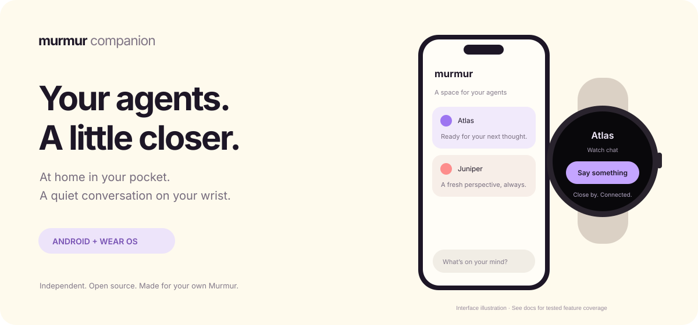
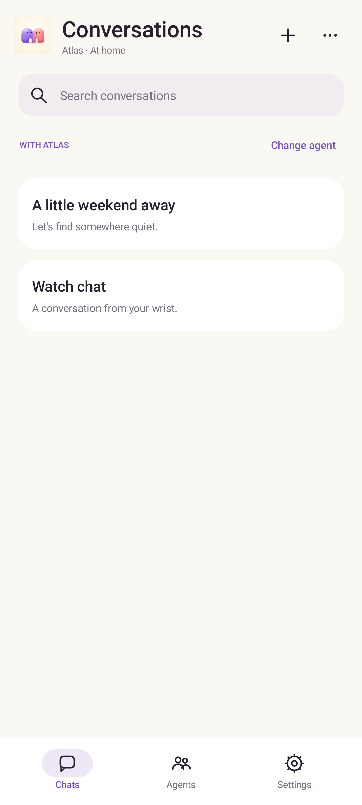
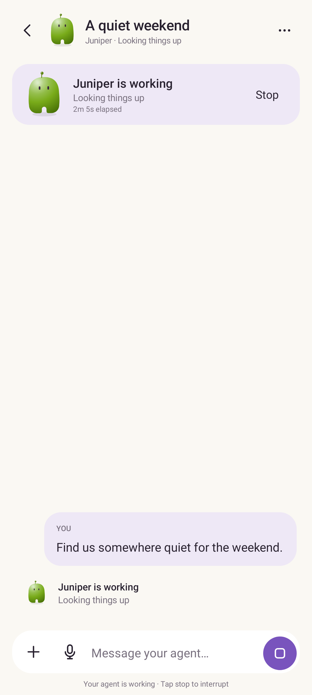
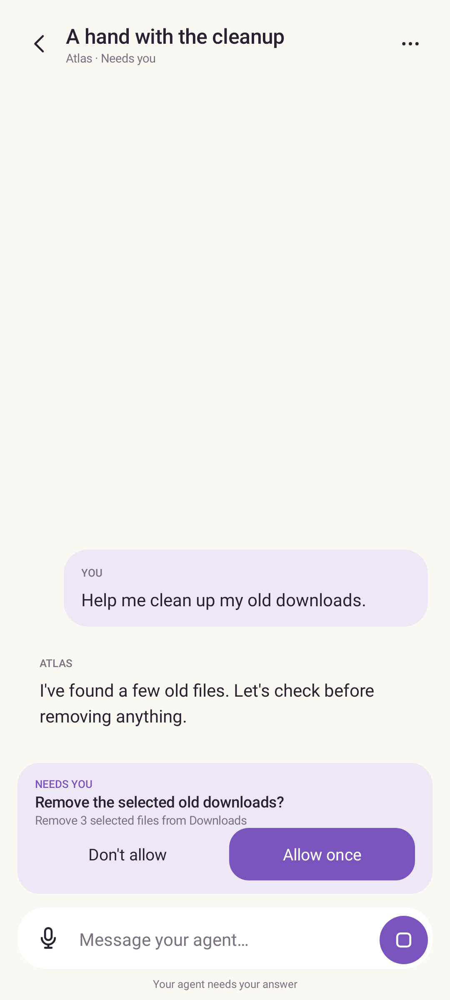
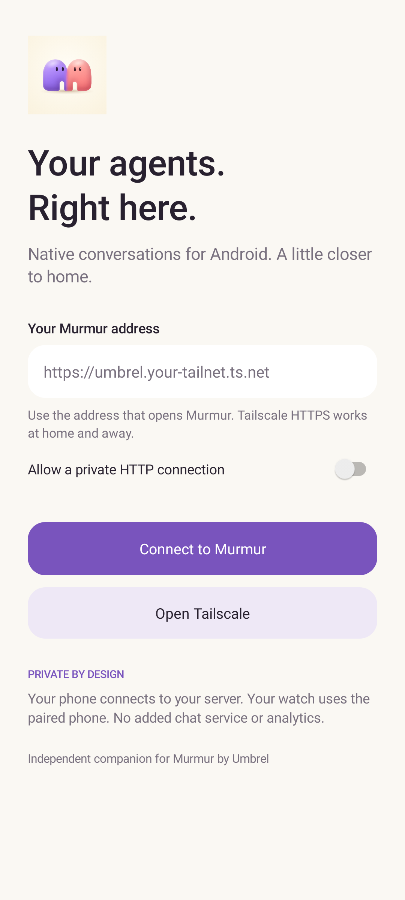
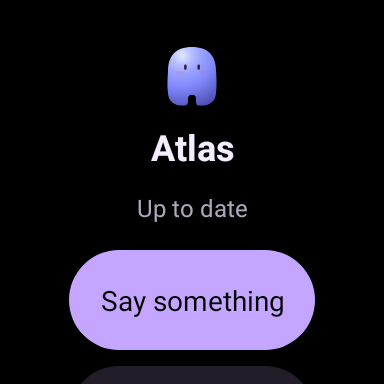
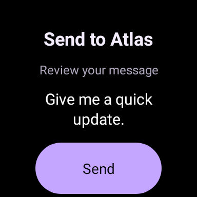

<p align="center"></p>

<p align="center">
  <strong>Your Murmur. In your pocket. On your wrist.</strong><br />
  An independent Android app and a small, thoughtful Wear OS companion for <a href="https://github.com/getumbrel/murmur">Murmur by Umbrel</a>.
</p>

<p align="center">
  <a href="https://carter-scramlin.github.io/murmur-companion/">Download website</a> ·
  <a href="https://github.com/carter-scramlin/murmur-companion/releases">Releases & APKs</a> ·
  <a href="docs/INSTALL.md">Install</a> ·
  <a href="docs/TAILSCALE.md">Connect with Tailscale</a> ·
  <a href="docs/FEATURES.md">Feature coverage</a> ·
  <a href="docs/DEVELOPMENT.md">Build & contribute</a>
</p>

---

### A familiar home for your agents

**Beta 2 fixes preview install conflicts and expands the native Android experience.** Choose an agent, open a conversation and talk using Android lists, a native composer and streamed text replies. No webpage is created for those screens.

Native Buddy characters follow each agent’s colour and show its mood. A persistent activity card spells out Thinking, Working, Replying or Needs you, with elapsed time and Stop. Reduced-motion controls are included.

Conversations and connections stay in memory as you navigate. Replies update directly over a persistent WebSocket. Dictate into a draft, review before sending, stop a response, rename chats, copy text, and answer approvals or clarification questions using native controls. Drafts survive navigation and Android Activity recreation.

The explicit **Full Murmur workspace** remains available for sign-in, groups, models, memories, routines, integrations, attachments and rich tool content. Those advanced screens still use your server's web interface. [See exactly what is native →](docs/FEATURES.md)

<p align="center"> &nbsp;  &nbsp; </p>

<p align="center"><sub>Android runtime renders using test fixtures. These are native views, not browser screenshots.</sub></p>

### Less on your wrist. Enough to be useful.

Choose an agent. Speak or type a short message. Review it, send it, and read the reply. Turn the crown to scroll. Replies refresh while the agent is working and the app is visible.

Each agent gets a **Watch chat**, visible in Murmur on your other devices. The watch keeps up to eight recent messages plus an in-progress answer, shortened for a small round screen. Approvals, files and rich content continue on your phone. There is no automatic resend after an uncertain delivery.

<p align="center"> &nbsp;  &nbsp; </p>

<p align="center"><sub>Native Android layout renders with fixture data. <a href="docs/VALIDATION.md">What has been tested</a>.</sub></p>

### Home, even when you're away

The phone uses the normal Android Tailscale app, with support for MagicDNS names, tailnet IPs and Tailscale Serve HTTPS addresses. The watch relays through the paired phone using Google's Wear OS Data Layer. It doesn't need Tailscale installed on the watch, a second VPN, or your server's credentials.

```text
Pixel Watch  ← Wear OS Data Layer →  Android phone  ← Tailscale →  Murmur → Hermes
                                      signed in                 your server
```

### Install the first build

**Beta: 0.3.0-beta.2.** Android 9+ on the phone; Wear OS 3+ on a paired watch. Pixel Watch is the intended watch form factor. Google Play services is required on both devices for the watch connection.

**[Download the phone + watch APK bundle →](https://github.com/carter-scramlin/murmur-companion/releases/download/v0.3.0-beta.2/murmur-companion-0.3.0-beta.2-install.zip)** **Install `murmur-companion-phone-install.apk` on the phone and open Murmur Beta. It can coexist with the old app.** No build tools needed. Individual install/debug APKs, installation instructions and checksums are under [Releases](https://github.com/carter-scramlin/murmur-companion/releases/tag/v0.3.0-beta.2). Install the phone APK on Android, then install the matching watch APK using the wireless ADB steps in the guide.

To build from source, build both APKs together so they share the same signing certificate:

```bash
./gradlew :core:test :phone:testDebugUnitTest :wear:testDebugUnitTest :phone:assembleDebug :wear:assembleDebug
```

Install `phone/build/outputs/apk/debug/phone-debug.apk` on the phone and `wear/build/outputs/apk/debug/wear-debug.apk` on the watch. Open the phone app first, enter your Murmur address and sign in. Then open the watch app.

**[Full installation instructions →](docs/INSTALL.md)** Includes Android Studio, sideloading, Pixel Watch wireless debugging, signature checks, upgrades and troubleshooting.

**[Beta readiness and tester checklist →](docs/BETA.md)** Stable distribution signing and real phone/Pixel Watch checks are still required before a broad beta.

### What is ready, and what needs device validation

This beta uses a persistent private signing key and a separate beta application ID to avoid earlier preview signing conflicts; it is not a Play Store release or an official Umbrel product. **Complete native desktop/browser parity is not yet implemented**. Native features now include file/photo uploads, Murmur password sign-in, model selection, chat filing, paged history, offline reading, dark mode and opt-in reply following. Advanced features remain accessible through Full Murmur workspace. Android WebView does not support Web Push; some OAuth providers reject embedded sign-in; blob downloads and browser-specific media features need further integration. Open those flows in a supported browser. See the [coverage matrix](docs/FEATURES.md) before installing.

Automated tests exercise origin validation, private HTTP opt-in, authenticated requests, redirect refusal, out-of-order RPC responses, bounded watch transcripts, safe read-only behavior and one-time prompt submission. Android lint and APK builds are part of CI. [Validation details and the device checklist](docs/VALIDATION.md) distinguish checks actually run from hardware checks still needed.

### Built to stay yours

- No analytics SDK, account service or hosted relay added by this project.
- Sign-in stays in Android's app-private WebView storage. Hermes keys remain on Murmur's server.
- Watch access can be disabled in the phone menu. Watch handoff reminders require notification permission.
- HTTPS certificate errors stop the connection. Local HTTP requires a separate opt-in.
- App backup and device transfer are disabled for app data. Forget this device clears its WebView data and saved connection; server chats remain.

The Google Data Layer transport and the selected keyboard or speech recognizer have their own privacy behavior. Voice recognition may use a cloud service. This app does not promise an entirely offline voice pipeline. [Privacy](PRIVACY.md) · [Security](SECURITY.md)

### Project

| Module | Purpose |
|---|---|
| `phone` | Native Android conversations, retained state and streaming, explicit workspace/sign-in fallback and watch relay |
| `wear` | Native round-screen conversation UI, voice/keyboard input and crown scrolling |
| `core` | Endpoint policy, Murmur HTTP/WebSocket client and watch actions, with JVM tests |

[Architecture and development](docs/DEVELOPMENT.md) · [Release signing](docs/RELEASING.md) · [Contributing](CONTRIBUTING.md) · [Changelog](CHANGELOG.md)

MIT licensed. Murmur's icon is used under its MIT license; see [third-party notices](THIRD_PARTY_NOTICES.md). Murmur and Umbrel belong to their respective owners. This project is **not affiliated with or endorsed by Umbrel, Google or Tailscale**.
