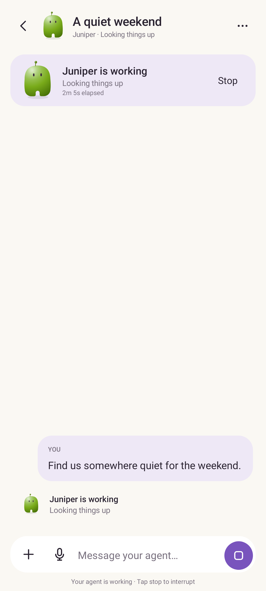
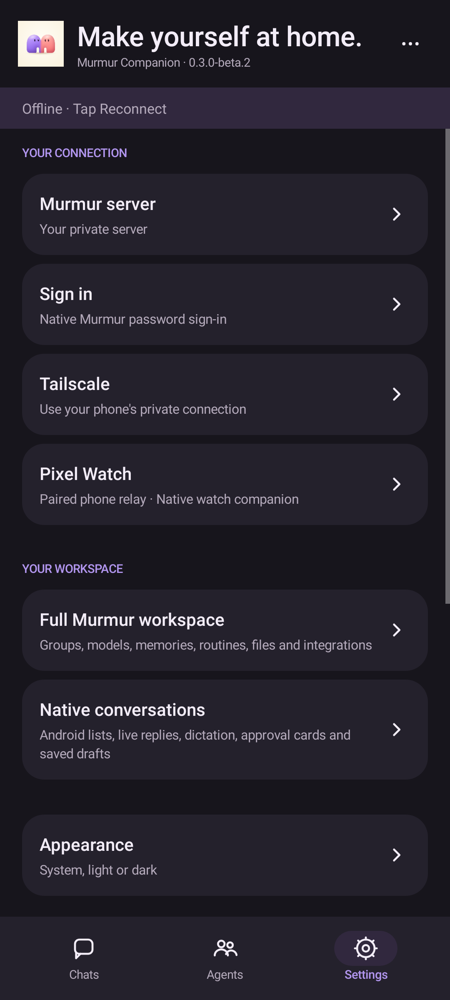
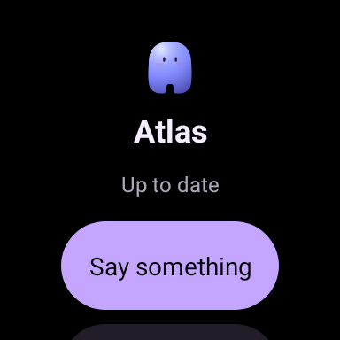
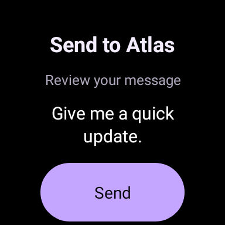

# Validation record — 0.3.0-beta.2

Prepared November 13, 2026. These checks describe this source and the matching install/debug APKs. They do not certify a physical phone, Pixel Watch or every Murmur server version.

## Automated checks

`./scripts/package-beta.sh` runs core, phone and watch unit tests, Android lint, optimized release builds and debuggable builds, then verifies/package-signs the four outputs with the existing private beta key.

- **37 tests:** 25 core JVM, 11 phone Android runtime, one watch Android runtime. Android runtime fixtures use API 35 plus API 28 for the offline cache.
- Coverage includes origin/cookie isolation and refused redirects; native password login; multipart file upload to an explicit home; archived-chat revision fencing; attachment staging followed by exactly one prompt; streaming replay/offset/sequence handling; native plans/helper progress; watch read/create/send/stop contracts; no auto-send while waiting; native phone UI without a WebView; read-only reconnect; navigation/rotation/drafts; approval details and explicit consent; native character/activity/Stop; dark palette/settings; origin-isolated offline cache restoration without runtime IDs or pending private requests; watch review layouts.
- **Android lint:** zero errors. Warnings include pinned dependencies/target, English-only strings and accessibility/style suggestions. Native translations are not implemented.
- **Four APKs verified:** application ID `dev.murmur.companion.beta`, versionCode 4, versionName `0.3.0-beta.2`; matching pinned certificate; phone/watch hardware requirements; correct debugging flags. Install APKs are non-debuggable and use R8/resource shrinking. Debug APKs enable Android debugging and also shrink resources/code.
- **Publishing:** the GitHub publication workflow verifies every checksum and certificate, checks that staged files are the only differences from the tested source commit, and requires successful CI on that source commit before publishing. Private signing material never enters the publication branch or release.

The phone/watch layout renders use local fixture data in Robolectric. Their pixels come from Android views, not a connected personal server or a physical device. The host's earlier emulator attempt crashed before boot; no emulator installation result is claimed.

## Inspected upstream contracts

[getumbrel/murmur](https://github.com/getumbrel/murmur), revisions `27253d221302af4c2b76b95f993428d698322519` and `2791c7e5234bae4ca0ad050c404b7b3913f687ab`: session access/password cookies, authenticated Hermes routing, session list/resume/submit/interrupt/delete, stored-message paging, mutation snapshots, file upload/attach, image attach/detach, model/config controls, profiles, renderer requests and events. Local fixtures follow these contracts; they are not live-server certification.

## Device validation still needed

- Install alongside the old preview on the user's phone; pair with the matching beta on Pixel Watch. Test switching between install/debug variants with settings retained.
- Native password sign-in and actual Umbrel gateway sign-in; multiple Hermes homes and current live API behavior.
- Real photo/file delivery, model changes and agent personality editing on test agents.
- Wi-Fi/cellular Tailscale transitions, denied access, expired sign-in, server restarts and uncertain sends.
- Foreground reply following with screen off, Android power restrictions, network loss and notification delivery/mirroring. It is a visible 30-minute activity monitor, not general Web Push.
- Watch Data Layer wakeup while the phone is backgrounded, nearby Bluetooth and remote connectivity, watch Stop and exact phone handoff.
- TalkBack, large fonts, reduced motion, dictation, system text-to-speech, crown input and both watch sizes.
- Groups, routines, memories, integrations and interactive browser tools through Workspace. OAuth provider restrictions, blob exports, general Web Push, widgets, watch tiles/complications and standalone watch networking remain unimplemented client integrations.

## Native runtime renders

 

  

 

