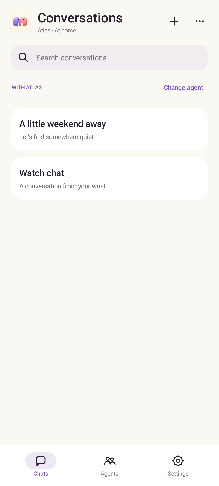
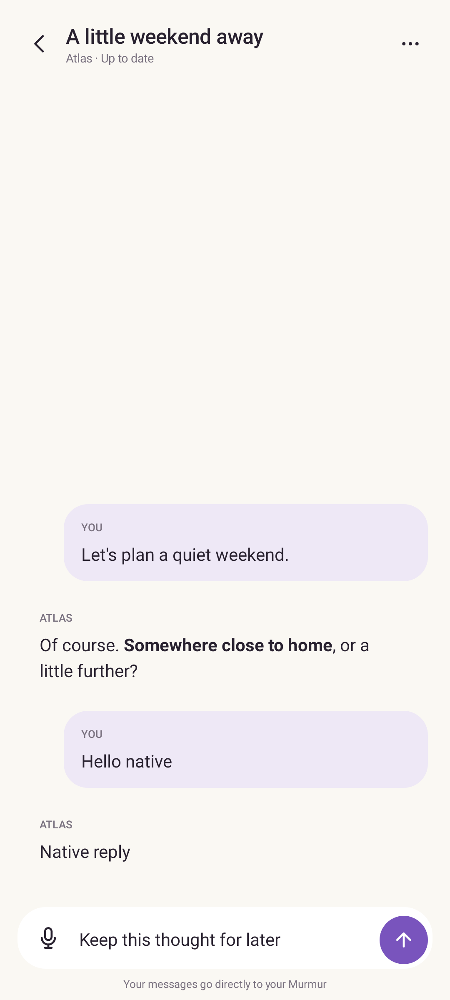
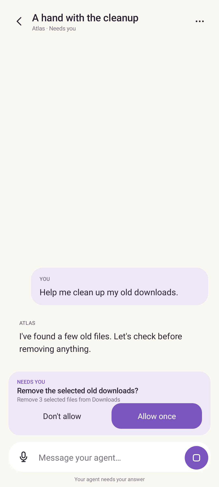

# Validation record

Native preview 0.2.0, prepared November 13, 2026. These results describe this build, not all future versions of Murmur, Android or Wear OS.

## Passed locally

```bash
./gradlew :core:test :phone:testDebugUnitTest :wear:testDebugUnitTest :phone:assembleDebug :wear:assembleDebug :phone:lintDebug :wear:lintDebug
```

- **16 core JVM tests:** streaming events and explicit server-request answers, stream offset/sequence deduplication, resumed in-flight replies, gap detection, request restoration/cancellation, plus origin parsing and matching, private HTTP opt-in, invalid addresses, authenticated request headers, no cookie forwarding across HTTP redirects, login HTML refusal, read without chat creation, exact watch-chat create/send sequence, stored/runtime session IDs, no send while approval is waiting, bounded transcripts, out-of-order RPC response matching, and multi-Hermes agent identity with unavailable homes skipped. Some tests cover several assertions.
- **4 Android runtime tests using Robolectric, Android API 35:** native phone HTTP/WebSocket fixture flow without a WebView, one prompt submission, native reply streaming, draft survival across Activity recreation, native approval details/confirmation without automatic permission; phone onboarding creates successfully and rejects a credential-bearing URL; watch round-screen chat/review layouts render and reviewing a dictated draft does not initiate a send. Draft state is preserved for restoration. These are JVM Android runtime tests, not physical-device tests.
- **Both debug APKs compile.** Their package IDs match. APK signatures and certificates are checked separately before packaging the local pair.
- **Android lint:** zero errors. Remaining warnings concern an intentionally pinned target/dependency version and English-only native strings. Native strings are not localized in this preview.
- **Visual review:** native phone onboarding, conversation list, transcript/composer and approval cards rendered at 1080 × 2400 with 411 × 914 dp qualifiers; watch agent/review screens rendered at 384 × 384 with 192 dp round-display qualifiers. See the images below. No emulator or physical-device screenshot is represented by these renders.

The Android emulator on this host crashed in its native QEMU process before Android boot completed, with and without Vulkan enabled. This prevented an emulator smoke test; it is not evidence that the app launched on a device.

## Upstream inspected

- Repository: [getumbrel/murmur](https://github.com/getumbrel/murmur)
- Commits: `27253d221302af4c2b76b95f993428d698322519` (original baseline) and `2791c7e5234bae4ca0ad050c404b7b3913f687ab` (native RPC/events contract checked November 13).
- Inspected contracts: Murmur connection routing, session access cookies, authenticated Hermes proxy, generated JSON-RPC types, agent naming metadata and chat create/resume/submit calls.
- Umbrel deployment boundary: [Murmur app proxy configuration](https://github.com/getumbrel/umbrel-apps/blob/master/murmur/docker-compose.yml).

The contract tests use local fixtures consistent with that inspected source. They are **not** a live-server compatibility certification. Upstream modifications can affect the native phone and watch clients.

## Still required before a public stable release

- [ ] Install the matching signed pair on the user's phone and Pixel Watch.
- [ ] Sign in through the actual Umbrel app proxy and standalone Murmur password flow.
- [ ] Verify Data Layer service wakeup while the phone app is in the background.
- [ ] Test Bluetooth nearby, Wi-Fi/remote Data Layer availability, phone screen off and phone unreachable.
- [ ] Connect with a full Tailscale MagicDNS HTTPS name; switch between home Wi-Fi and cellular.
- [ ] Check tailnet access denial, expired auth and server restarts.
- [ ] List agents from multiple Hermes connections; check unavailable homes and naming.
- [ ] Send from watch, confirm the Watch chat on the web, read a streamed reply and test a waiting approval.
- [ ] Test system dictation, keyboard, crown input, TalkBack, larger fonts and both Pixel Watch sizes.
- [ ] Test ambiguous send delivery and process death without duplicate automatic submission.
- [ ] Validate native phone streaming, stop, create/rename, approval/question cards, drafts, screen rotation, background return and exact Watch-chat handoff on real hardware.
- [ ] Test workspace images/files, Save as, browser popup sign-in, live widgets and supported voice/read-aloud flows.
- [ ] Close the documented Web Push, embedded OAuth, blob-download and media parity gaps before claiming full desktop/browser feature parity.
- [ ] Validate a stable release signing key and upgrades from an older installed version.

## Native layout renders

These are actual Android views rendered by Robolectric using fixture data. They demonstrate the local layouts, not a connected personal Murmur or successful watch pairing.

<p>  </p>

<p>  </p>
